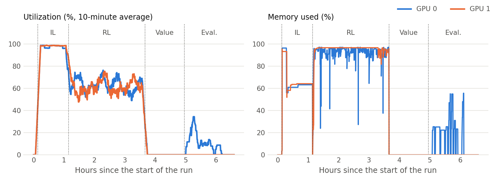
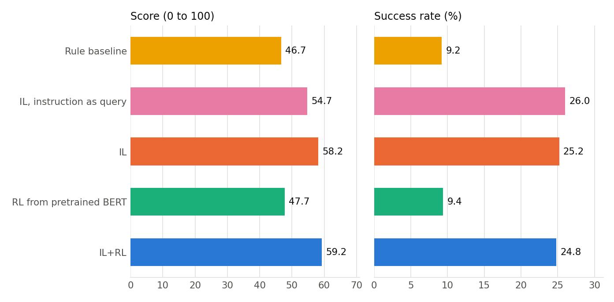
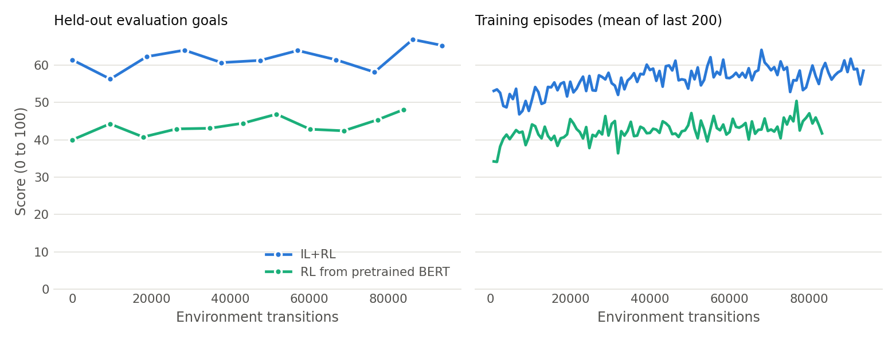
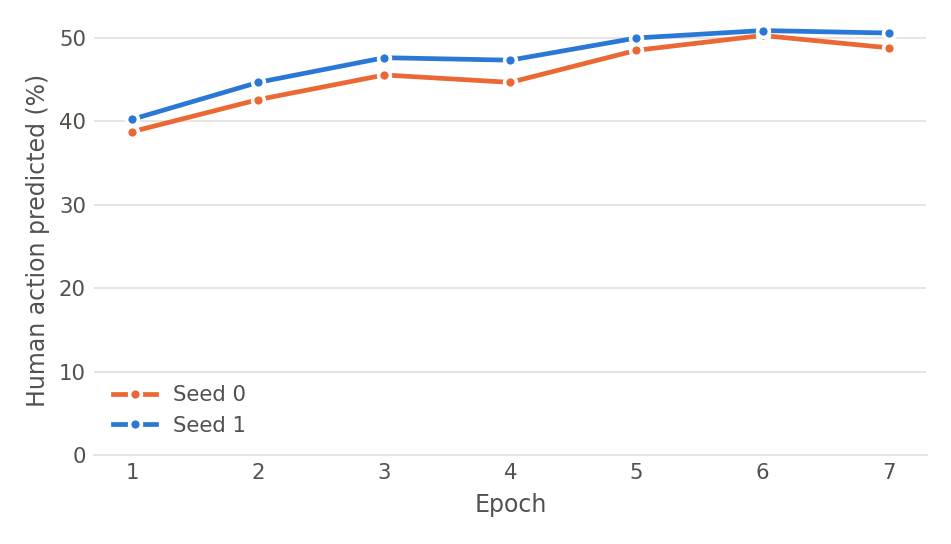
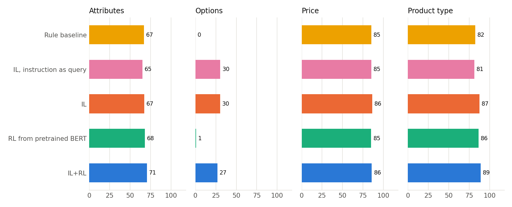
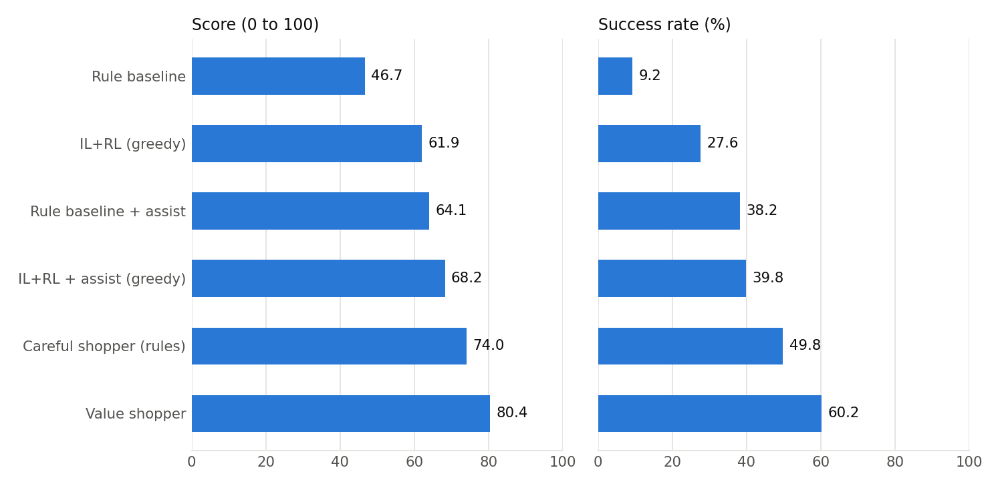

# Abstract

WebShop is a simulated online store in which an agent reads a shopping instruction, then searches, browses, selects options and buys a product. It is hard for reinforcement learning (RL): rewards arrive only at the end of an episode, the action set changes on every page, and states are long, noisy text. This project formulates the task as a Markov decision process, trains a BERT-based policy with advantage actor-critic (A2C), and measures how much a warm start from imitation learning (IL) helps, compared with RL starting from pretrained language weights alone. It also repairs defects in the original code that blocked training or changed results, and rebuilds the training loop around batched inference and mixed precision on two GPUs. Results are reported on the 500 held-out test instructions used by the original paper. A rule baseline scored 46.7, close to the 45.6 published for it. The warm start clearly helped: IL+RL scored 59.2 against 47.7 for RL from pretrained BERT. Fine-tuning did not reliably improve on IL alone when actions were sampled (58.2), but it made the agent much faster and stopped the looping that made the IL policy fail under greedy action selection (49.4 against 61.9). An earlier full run, made with an older version of the code, supports the same conclusions. A further agent learns a value function for the purchase decision from simulated purchases. It reached 80.4 with 60.2% success, close to the 82.1 and 59.6% published for human experts, though it uses hand-designed features and about 85 steps per episode.

# 1. Problem

An episode begins with a natural-language instruction, for example *"i want a noise cancelling usb microphone, and price lower than 40.00 dollars"*. The agent must find a matching product among real product listings, choose the requested options such as size and colour, and buy it. The environment comes from Yao et al. (2022), who reported that IL followed by RL fine-tuning clearly beats a rule-based baseline but stays far below human experts.

The questions studied here are:

1. How much does a warm start from human demonstrations improve an A2C agent?
2. Does A2C fine-tuning improve a policy that has already been trained by imitation?
3. Which part of the task (attributes, options, price or product type) limits each agent?

# 2. Formulation as an MDP

The task is an episodic, partially observed MDP.

- **State $s_t$.** The text of the current page, with markers for buttons and for what has been clicked, which includes the instruction. Tokens beyond the limit of 512 are cut from the start of the text. The environment's true state also holds hidden information (the product's sampled price and the goal), so the agent acts on an observation.
- **Actions $A(s_t)$.** The set depends on the page, which is why the policy scores actions rather than outputting a fixed-size vector. On the search page the actions are candidate queries: up to 10 generated by a pretrained BART model, plus the instruction itself. Elsewhere they are clicks on products, options, navigation buttons and *Buy Now*. Sets larger than 20 actions are reduced to the 6 navigation actions plus 10 sampled ones.
- **Transitions.** Deterministic given the search index and the action, apart from that sampling of large action sets.
- **Reward.** Zero until purchase, or until the limit of 100 steps ends the episode with reward zero. At purchase:

$$
r = r_{\text{type}} \cdot \frac{|U_{\text{att}} \cap Y_{\text{att}}| + |U_{\text{opt}} \cap Y_{\text{opt}}| + \mathbb{1}[\text{price} \le \text{limit}]}{|U_{\text{att}}| + |U_{\text{opt}}| + 1}
$$

where $U$ are the attributes and options the instruction asks for, $Y$ are those of the purchase, and $r_{\text{type}} \in \{0, 0.1, 0.5, 1\}$ penalizes buying the wrong kind of product. The training reward is scaled by 10. A *success* means $r = 1$, and the reported score is the mean of $100 \cdot r$.

- **Discount.** $\gamma = 0.9$.

The sparse terminal reward and the large action space make exploration the central difficulty: a random policy rarely reaches a purchase that teaches it anything about options or attributes.

# 3. Methods

## 3.1 Policy and value network

States and actions share one BERT encoder. A bidirectional attention layer relates each action's tokens to the state's tokens, and the attended representation is averaged and mapped to a single score, so

$$\pi(a \mid s) = \mathrm{softmax}_{a \in A(s)} \; f_\theta(s, a).$$

The value $V_\theta(s)$ is a small network on the state's first token. Policy and value share the encoder. Product images are not used in this project (see Section 7).

## 3.2 Imitation learning

The policy is first trained by behaviour cloning on human demonstrations, minimizing $-\log \pi(a_{\text{human}} \mid s)$ with AdamW (learning rate $2 \times 10^{-5}$, linearly decayed), keeping the weights with the best validation accuracy.

## 3.3 Advantage actor-critic

RL training uses synchronous A2C. From parallel environments it collects rollouts of $n = 8$ steps and computes n-step returns, bootstrapped with the value of the last state and cut at episode ends:

$$R_t = r_t + \gamma R_{t+1}, \qquad R_{t+n} = V_\theta(s_{t+n}).$$

The loss combines the policy gradient, value regression and an entropy bonus:

$$\mathcal{L} = -\log \pi(a_t \mid s_t)\,\big(R_t - V_\theta(s_t)\big)_{\text{detached}} + \big(R_t - V_\theta(s_t)\big)^2 + \sum_{a} \pi(a \mid s_t) \log \pi(a \mid s_t).$$

Actions are sampled from $\pi$ during training. Optimization uses Adam (learning rate $10^{-5}$) with the gradient norm clipped to 10.

## 3.4 Agents compared

| Agent | How it is trained | Search page | Other pages |
|---|---|---|---|
| Rule baseline | Not trained | The instruction | First result, then buy |
| IL | Behaviour cloning | First generated query | Sampled from $\pi$ |
| IL, instruction as query | Behaviour cloning | The instruction | Sampled from $\pi$ |
| RL from pretrained BERT | A2C only | Sampled from $\pi$ | Sampled from $\pi$ |
| IL+RL | Behaviour cloning, then A2C | Sampled from $\pi$ | Sampled from $\pi$ |

## 3.5 Agents added to raise the score

The results of the agents above showed where score was being lost, so three further agents were added to find out how far the score could be raised. They use only what is visible on the pages and leave the reward unchanged. Settings were chosen on validation goals and were not changed after the test goals were used, although faults found after the first test run meant that the added agents were run on them more than once (Section 6.5). They are reported separately in Section 6.5 because they rely on hand-written knowledge of the task, unlike the agents above.

**Assist mode** is a change to the environment that any agent can use. It hides products whose displayed price is certainly over budget, and on reaching a product it selects the closest option in each option group. A wrong selection cannot lower the reward and an empty group cannot raise it, so a guess is always made. It is applied to the rule baseline and to the trained IL+RL weights, without retraining them.

**The careful shopper** involves no learning. It runs two searches, opens the five most relevant results of each, compares them with the instruction using a hand-written score, and buys the best.

**The value shopper** learns an action-value function for the final decision, what buying a product will earn:

$$Q(s, \text{buy } p) = w^\top \phi(s, p)$$

where $\phi$ holds 33 features of the page text: how much of the instruction appears in the product's title, details and options; attribute phrases such as *long lasting*, which were listed from the training goals; the displayed price against the budget; and the search rank. For 2,000 training goals, every product returned by the two searches was bought in simulation and the reward recorded. The weights are ridge regression on the differences between a goal's products, because the agent only ever compares products within one goal. A second model of the same form uses title, price and rank alone.

The policy then reads the first two results pages of both searches, uses the title model to shortlist products, opens them to read their options, features and description, and buys the product with the highest $Q$, with the closest option in each group selected. It stops inspecting in time to return and buy within the 100-step limit.

This is one-step value learning from sampled rewards, not deep RL. It is a linear model on hand-designed features, the sequence of navigation steps is fixed by hand, and it uses many more steps per episode than the trained agents.

# 4. Engineering for GPU throughput

The original loop encoded states one at a time, ran BERT twice per state, and held computation graphs for the whole rollout. It was rewritten to make much heavier use of the GPU:

- **One batched pass.** All environments are encoded together, and policy and value share that pass.
- **Mixed precision.** 16-bit floats on the GPU for both training and inference.
- **Memory-adaptive micro-batches.** An update is split into micro-batches by token count. The limit grows until 80% of GPU memory is in use and halves on an out-of-memory error, so a long run does not crash.
- **Length bucketing and dynamic padding.** Similar-length samples are grouped so little GPU work is spent on padding.
- **Parallel environments.** Environments run in worker processes that share the catalogue through copy-on-write memory.
- **Cheaper environment steps.** Pages are parsed once per step, templates are compiled once, and redundant hidden page visits and per-step reward estimates were removed.
- **One experiment per GPU.** The two T4 GPUs run different experiments at once, giving two results in the time of one and avoiding the overhead of `DataParallel`.
- **Fault tolerance.** Training has a wall-clock limit and periodic checkpoints, and can resume.

| Stage (GPU 0 / GPU 1) | Mean utilization (%) | Samples at 0% utilization (%) | Mean memory (%) |
|---|---:|---:|---:|
| Imitation learning | 96 / 98 | 1 / 1 | 66 / 67 |
| Reinforcement learning | 63 / 61 | 22 / 26 | 92 / 95 |
| Value model | 0 / 0 | 100 / 100 | 0 / 0 |
| Evaluation | 9 / 0 | 88 / 100 | 13 / 0 |

*Sampled with `nvidia-smi`. Its memory figure includes the cache PyTorch keeps reserved, so it is higher than the 80% budget that the micro-batches aim for.*

# 5. Experimental setup

Splits follow the paper: goals 0 to 499 for test, 500 to 1,499 for validation, and the rest for training, after a fixed-seed shuffle. Test scores are computed once per test goal, sampling actions from the policy as the paper does. Greedy evaluation is also reported.

- **Training catalogue:** 200,000 products, including all 10,136 products with a human instruction. A smaller catalogue makes search faster and saves memory.
- **Test catalogue:** 1,181,430 products. Testing on the full catalogue keeps scores comparable with the paper, because a small catalogue makes the task easier.
- **Hardware:** 2 x Tesla T4. Training ran one experiment per GPU at the same time; evaluation on the full catalogue ran one agent at a time.
- **Library versions:** Python 3.10.22, PyTorch 2.2.2+cu121, Transformers 4.41.2, spaCy 3.3.0.
- **IL seed 0:** 8,237 training samples, best validation accuracy 50.3%, 60 minutes, stopped by the 60-minute limit during epoch 7 of 10.
- **IL seed 1:** 8,237 training samples, best validation accuracy 50.9%, 60 minutes, stopped by the 60-minute limit during epoch 7 of 10.
- **IL+RL training:** 93,696 transitions, 732 updates, 25,738 episodes, 2.5 hours; median 10.7 transitions per second.
- **RL from pretrained BERT training:** 83,840 transitions, 655 updates, 25,528 episodes, 2.5 hours; median 9.5 transitions per second.

Differences from the paper that may affect the comparison:

- **Search.** BM25 on SQLite FTS5 replaces Lucene, which removes the Java dependency. Its parameters and tokenizer differ slightly.
- **Text only.** Image features are not used. The paper's best models used them.
- **Reward fidelity.** The reward logic is unchanged. The part-of-speech tagger uses the same `en_core_web_lg` 3.3 weights as the original code's tests, which pass.
- **Training catalogue.** Agents train on a subset of the catalogue that contains every goal product, and are tested on the full catalogue.
- **Search queries.** Queries come from the BART predictions that ship with the repository, rather than being generated at test time.
- **Budget.** RL was trained for a fixed time rather than for the paper's number of steps.

The agents of Section 3.5 were developed after a first Kaggle run, on a laptop CPU with the catalogue served from disk because the laptop had too little memory to hold it. Their settings were chosen there on validation goals: the value model's on the full catalogue, the careful shopper's on a 200,000-product catalogue. The whole pipeline, including these agents and the training of the value model on the same 2,000 training goals, was then run a second time on Kaggle. All test results in Section 6 come from that second run. The first run, made with an earlier version of the code, is compared with it in Section 6.6.

# 6. Results

## 6.1 Test performance

| Agent | Score | 95% CI | Success (%) | Attributes | Options | Price | Type | Steps | Results pages* | Products opened* |
|---|---:|---:|---:|---:|---:|---:|---:|---:|---:|---:|
| Rule baseline | 46.7 | 44.1 to 49.2 | 9.2 | 66.9 | 0.0 | 85.2 | 82.4 | 3.2 | 1.00 | 1.00 |
| IL, instruction as query | 54.7 | 51.5 to 57.8 | 26.0 | 65.1 | 30.4 | 85.2 | 81.2 | 9.2 | 1.96 | 1.62 |
| IL | 58.2 | 55.3 to 61.0 | 25.2 | 67.2 | 30.2 | 86.4 | 87.5 | 9.1 | 1.88 | 1.61 |
| RL from pretrained BERT | 47.7 | 45.3 to 50.1 | 9.4 | 67.9 | 0.7 | 85.0 | 86.5 | 3.1 | 1.00 | 1.00 |
| IL+RL | 59.2 | 56.4 to 62.0 | 24.8 | 70.6 | 26.9 | 85.8 | 89.1 | 3.6 | 1.01 | 1.01 |
| IL (seed 1) | 60.8 | 57.9 to 63.7 | 27.6 | 69.4 | 32.0 | 85.8 | 89.0 | 8.5 | 1.89 | 1.71 |
| IL (greedy) | 49.4 | 45.8 to 53.0 | 28.2 | 53.8 | 35.6 | 66.4 | 65.0 | 28.1 | 8.98 | 6.25 |
| RL from pretrained BERT (greedy) | 51.4 | 49.0 to 53.8 | 11.8 | 70.5 | 0.0 | 89.4 | 91.1 | 3.0 | 1.00 | 1.00 |
| IL+RL (greedy) | 61.9 | 59.2 to 64.7 | 27.6 | 73.7 | 29.4 | 87.6 | 90.1 | 3.9 | 1.00 | 1.00 |

*Score intervals are 95% bootstrap intervals over the goals. Attributes, options, price and type are the mean reward components over all goals, as percentages, so a goal that requests no options counts as zero under Options. \*The site counts these since the episode's last return to the search page, and counts a results page each time it is shown, including through Next and Prev, so they understate the activity of agents that search more than once.*

Published results, for reference:

| Agent (published) | Score | Success (%) |
|---|---:|---:|
| Rule | 45.6 | 9.6 |
| IL | 59.9 | 29.1 |
| IL+RL | 62.4 | 28.7 |
| Human expert | 82.1 | 59.6 |

## 6.2 Paired comparisons

All agents face the same goals, so differences are measured per goal:

- **IL+RL minus IL:** +1.0 points (paired 95% bootstrap interval -1.9 to +3.9); the interval includes zero, so these goals do not show a reliable difference.
- **IL+RL minus RL from pretrained BERT:** +11.5 points (paired 95% bootstrap interval +8.8 to +14.1); IL+RL scored higher, and the interval excludes zero.
- **IL minus Rule baseline:** +11.5 points (paired 95% bootstrap interval +8.3 to +14.7); IL scored higher, and the interval excludes zero.
- **RL from pretrained BERT minus Rule baseline:** +1.1 points (paired 95% bootstrap interval -1.6 to +3.7); the interval includes zero, so these goals do not show a reliable difference.
- **IL minus IL, instruction as query:** +3.5 points (paired 95% bootstrap interval +0.1 to +6.8); IL scored higher, and the interval excludes zero.
- **IL seed 0 minus IL seed 1:** -2.7 points (paired 95% bootstrap interval -5.3 to -0.0); Seed 0 scored lower, and the interval excludes zero.
- **IL+RL (greedy) minus IL (greedy):** +12.6 points (paired 95% bootstrap interval +9.0 to +16.1); IL+RL (greedy) scored higher, and the interval excludes zero.
- **IL+RL (greedy) minus IL+RL (sampled):** +2.7 points (paired 95% bootstrap interval +0.5 to +5.0); IL+RL (greedy) scored higher, and the interval excludes zero.

## 6.3 Learning curves

## 6.4 Where the score is lost

## 6.5 Raising the score

Settings of the value shopper were compared on the 1,000 validation goals, and the highest-scoring one was then evaluated on the test goals:

| Value shopper settings (validation) | Score | 95% CI | Success (%) | Steps |
|---|---:|---:|---:|---:|
| First model, no attribute phrases: 2 pages, 8 inspected | 78.6 | 76.8 to 80.4 | 54.0 | 62.6 |
| First model, no attribute phrases: 1 page, 10 inspected | 79.1 | 77.4 to 80.9 | 55.1 | 71.5 |
| First model, no attribute phrases: 2 pages, 12 inspected | 79.3 | 77.6 to 81.1 | 55.7 | 83.8 |
| Final model: 2 pages per search, 12 inspected | 80.6 | 78.8 to 82.4 | 58.7 | 83.9 |
| Final model: 2 pages per search, 14 inspected (chosen) | 80.8 | 79.1 to 82.6 | 58.3 | 85.0 |

Test results of the added agents, on the same 500 goals and full catalogue as Section 6.1, with the same columns:

| Agent | Score | 95% CI | Success (%) | Attributes | Options | Price | Type | Steps | Results pages* | Products opened* |
|---|---:|---:|---:|---:|---:|---:|---:|---:|---:|---:|
| Rule baseline + assist | 64.1 | 61.0 to 67.1 | 38.2 | 68.3 | 40.0 | 98.0 | 83.3 | 4.2 | 1.00 | 1.00 |
| IL+RL + assist (greedy) | 68.2 | 65.4 to 71.0 | 39.8 | 73.3 | 39.3 | 98.0 | 89.9 | 4.9 | 0.99 | 0.99 |
| Careful shopper (rules) | 74.0 | 71.3 to 76.7 | 49.8 | 76.9 | 51.7 | 99.2 | 90.2 | 66.8 | 4.22 | 4.22 |
| Value shopper | 80.4 | 77.8 to 82.9 | 60.2 | 90.6 | 55.4 | 99.6 | 91.1 | 85.1 | 2.60 | 2.36 |

- **Value shopper minus IL+RL (greedy):** +18.5 points (paired 95% bootstrap interval +15.7 to +21.3); Value shopper scored higher, and the interval excludes zero.
- **Value shopper minus Careful shopper:** +6.4 points (paired 95% bootstrap interval +4.2 to +8.6); Value shopper scored higher, and the interval excludes zero.
- **Careful shopper minus Rule baseline + assist:** +9.9 points (paired 95% bootstrap interval +6.9 to +13.0); Careful shopper scored higher, and the interval excludes zero.
- **IL+RL + assist (greedy) minus IL+RL (greedy):** +6.3 points (paired 95% bootstrap interval +4.8 to +7.8); IL+RL + assist (greedy) scored higher, and the interval excludes zero.
- **Rule baseline + assist minus Rule baseline:** +17.4 points (paired 95% bootstrap interval +15.6 to +19.3); Rule baseline + assist scored higher, and the interval excludes zero.

*Before this Kaggle run, the added agents were developed on a laptop and evaluated there on the test goals more than once, because faults were found after the first evaluation. Their settings did not change between runs. (1) The text view never showed an option containing a double quote, such as `20"x20"`, as selected, so assist mode and the shoppers clicked it again and again. The reward was not affected, because the site recorded the click. This was fixed in the text view, and the agents were changed never to repeat a click on the same visit. The first evaluation, before this fix, gave Careful shopper (rules) 71.8 and 48.4%; IL+RL + assist (greedy) 63.1 and 36.0%; Rule baseline + assist 60.5 and 35.2%; Value shopper 80.1 and 59.4%. (2) A change made for this work let assist mode treat the product buttons on a results page as option buttons, so it opened a product on the agent's behalf. Only the two agents that use assist mode were affected, and the fault was found from their low price credit in the second evaluation, which gave IL+RL + assist (greedy) 63.9 and 36.6%; Rule baseline + assist 60.5 and 35.4%. They were evaluated a third time after the fix. The third laptop evaluation and this Kaggle run gave identical scores on every test goal for the careful shopper, the rule baseline with assist and the value shopper. IL+RL + assist (greedy) uses the IL+RL weights, which this run trained again, so its score differs (67.1 on the laptop with the first run's weights). The validation runs above were made before fix (1); fault (2) did not affect the value shopper or the careful shopper.*

## 6.6 A second run

The whole pipeline was run twice on Kaggle with the same settings. The run reported above used a later version of the code than the first, with three changes that can affect the trained agents. States are truncated from the right instead of the left, so the instruction is no longer cut off on long pages (Section 7). The text view shows options containing a double quote as selected (Section 6.5). Imitation learning remembers how far it had to split a batch after running out of GPU memory, instead of failing and splitting again on nearly every batch, so it trained further in its 60 minutes. Differences between the runs therefore mix these changes with ordinary variation between training runs, and cannot be put down to either alone. The rule baseline is affected by neither, and scored the same on every goal in both runs.

| Agent | First run | This run | Difference | Paired 95% CI | Goals at the step limit (first / this) |
|---|---:|---:|---:|---:|---:|
| Rule baseline | 46.7 | 46.7 | +0.0 | +0.0 to +0.0 | 1 / 1 |
| IL, instruction as query | 54.8 | 54.7 | -0.1 | -3.3 to +3.0 | 1 / 0 |
| IL | 57.1 | 58.2 | +1.1 | -1.7 to +3.9 | 0 / 1 |
| RL from pretrained BERT | 47.4 | 47.7 | +0.3 | -1.9 to +2.5 | 0 / 0 |
| IL+RL | 55.7 | 59.2 | +3.4 | +0.8 to +6.2 | 0 / 0 |
| IL (seed 1) | 53.5 | 60.8 | +7.3 | +4.6 to +10.1 | 1 / 0 |
| IL (greedy) | 34.6 | 49.4 | +14.8 | +11.2 to +18.4 | 249 / 124 |
| RL from pretrained BERT (greedy) | 49.8 | 51.4 | +1.6 | -0.1 to +3.4 | 0 / 0 |
| IL+RL (greedy) | 60.5 | 61.9 | +1.4 | -1.0 to +3.8 | 2 / 2 |

*Differences are this run minus the first, paired over the same 500 goals.*

# 7. Discussion and limitations

**Is the setup faithful to the paper?** The rule baseline learns nothing, so it is the most direct test of the environment, search and reward. It scored 46.7 with 9.2% success, against 45.6 and 9.6% in the paper. The learned agents fell a little short of their published results: IL reached 58.2 and 25.2% against 59.9 and 29.1%, and IL+RL reached 59.2 and 24.8% against 62.4 and 28.7%. This run cannot separate the possible causes, which include text-only input, imitation learning that stopped early, a smaller training catalogue and a different BM25 implementation.

**How much does a warm start help?** It helps clearly. IL+RL beat RL from pretrained BERT by 11.5 points (interval +8.8 to +14.1), with 24.8% success against 9.4%. Without demonstrations, A2C converged on a policy close to the rule baseline, and the two are not reliably different (+1.1, interval -1.6 to +3.7 for sampled actions). It searches once, opens one result and buys it in 3.1 steps, and it almost never selects an option: on the 391 test goals that request options it earned 0.9% of the option credit. This fits the sparse reward: buying immediately already earns a good score, and an agent that has never been shown option selection rarely discovers that it pays.

**Does A2C improve a policy trained by imitation?** Not in score when actions are sampled: IL+RL minus IL is +1.0 points (interval -1.9 to +3.9). It did change behaviour. Mean episode length fell from 9.1 to 3.6 steps, so the agent reached about the same reward much faster. A discount of 0.9 shrinks a purchase reward by about 10% for each extra step, which is a likely reason for this shift. The cost was fewer option clicks after the last return to the search page (0.51 per episode against 1.03) and slightly less option credit.

The clearest benefit appears under greedy action selection. Greedy IL hit the 100-step limit on 124 of the 500 goals and bought a product in only 75.2% of them, moving back and forth between pages, and scored 49.4. When it did buy, it bought well: its 28.2% success rate is the highest of the agents trained by imitation or A2C. Greedy IL+RL hit the limit on 2 goals and scored 61.9, a gain of 12.6 points (interval +9.0 to +16.1). This was also the best score among those agents, at 27.6% success. It should be read with care: it is one of thirteen evaluations of the same test goals, and the comparison with the paper is made on sampled actions.

**What limits each agent?** Options are the weakest component. Because the table counts goals with no requested options as zero, the fairer figures use the 391 of 500 test goals that do request options: IL earned 38.6% of the option credit on those goals, IL+RL 34.4% and greedy IL+RL 37.6%, while the rule baseline earned 0% and RL from pretrained BERT 0.9%. Options are also where IL differs most from the rule baseline. Among the sampled agents, attribute credit barely separates them (65.1% to 70.6%, with the rule baseline at 66.9%), which suggests that the search ranking does most of that work and that the learned agents add little by choosing among results. Price (85.0% to 86.4%) and product type (81.2% to 89.1%) are the strongest components.

**How far can the score be raised?** Section 6.5 tested this directly. Two kinds of change helped, and both were measured on validation goals before the test goals were used.

The first is to stop wasting credit that is visible on the page. Assist mode hides products whose displayed price is certainly over budget, and selects the closest option in each group. It raised the rule baseline by 17.4 points (interval +15.6 to +19.3) and the trained IL+RL weights, under greedy selection and without retraining, by 6.3 points (interval +4.8 to +7.8). Most of the IL+RL gain came from price: price credit rose from 87.6% to 98.0%. The learned policy had never been taught to read the budget.

The second is to compare more products before buying, which mattered more. On validation goals, a perfect choice among the products that the two searches return would have scored about 92, while buying the first result scored about 61, so ranking lost far more than search did. The value shopper closes much of that gap. It beat the careful shopper, which compares the same kind of information with a hand-written score, by 6.4 points (interval +4.2 to +8.6), and greedy IL+RL by 18.5 points (interval +15.7 to +21.3). Its validation and test results agree closely: 80.8 and 58.3% on validation, 80.4 and 60.2% on test. It gained most on attributes (90.6% against 73.7% for greedy IL+RL) and on options, where it earned 70.8% of the credit on the 391 goals that request options, against 37.6% for greedy IL+RL. Reading each product's features and description matters: in an offline comparison on validation goals with the 200,000-product catalogue and the first set of features, choosing without those pages lowered the score of the chosen products from 81.3 to 78.0.

This score should be read with three caveats. It is not deep RL: the value function is linear on features designed by hand, and the navigation is fixed. It uses about 85 steps per episode, against 3 to 9 for the trained agents under sampled actions, because it reads two results pages for each of two searches and opens 14 products. The reward has no cost per step, so this is allowed, but it is not the same budget the trained agents worked with. Finally, the added agents were evaluated on the test goals three times on a laptop before this run, because two faults were found after the first evaluation (Section 6.5). The settings did not change, and this run reproduced the last laptop evaluation exactly, but repeated use still weakens the guarantee that comes from a single look at the test set.

**Had training finished?** No. For IL+RL, the validation score started at 61.4 with the imitation weights, fell to 56.3 at the first check as the policy shifted, and then moved between 58.1 and 66.9, ending at 65.3. The mean score of its last 200 training episodes fell from about 53 to about 47 early on, then climbed to between 55 and 62 over the last stretch. For RL from pretrained BERT, the validation score rose from 40.0 to 48.1, its highest value, at the last check, and the training score from about 34 to between 42 and 50. Neither curve had clearly flattened, so longer training may help. Validation scores are noisy because they use 100 goals, and the saved "best" model was chosen on these scores, though the test goals played no part in that choice.

**How well were the GPUs used?** Imitation learning kept both GPUs at about 97% utilization. Reinforcement learning did not reach that: mean utilization was about 62%, and the GPUs were idle in about a quarter of samples, because they waited for environment steps and search on the CPU. Throughput was a median of 10.7 and 9.5 transitions per second. A faster GPU would help this stage less than a faster environment would. Evaluation ran one agent at a time, because every job holds the full catalogue in memory, and it was limited by the CPU: mean GPU utilization was under 10%. The value model's simulated purchases took 78 minutes on the CPU alone, and the whole run 6.6 hours.

**Do the conclusions hold across runs?** Section 6.6 compares this run with an earlier full run made with an older version of the code. The retrained agents moved: sampled IL+RL by +3.4 points (interval +0.8 to +6.2), the second IL seed by +7.3, and greedy IL by +14.8, with the goals that reached the step limit falling from 249 to 124. The other retrained agents changed by less than 2 points, with intervals that include zero, and the rule baseline did not change at all. The conclusions above held in both runs: the warm start beat RL from pretrained BERT by 8.3 and 11.5 points, IL+RL and IL were never reliably different under sampled actions (-1.3 and +1.0), RL from pretrained BERT stayed close to the rule baseline (+0.7 and +1.1), and greedy IL+RL beat greedy IL by 25.9 and 12.6 points.

Limitations of this particular run:

- **Imitation learning stopped early.** Both seeds reached the 60-minute limit during epoch 7 of the 10 planned, before the learning rate had finished decaying, so the last epoch in the accuracy figure is only partial and IL may be underfitted. In the first run, batches of 32 often did not fit in GPU memory and were retried about 1,400 times per seed; the code now remembers the split, the retry message appears twice per seed, and IL trained about one epoch further.
- **Seed variation is as large as some effects.** The two IL seeds differ by 2.7 points (interval -5.3 to -0.0), with seed 1 better here, while seed 0 was better by 3.5 points in the first run. IL+RL started from seed 0 in both runs, so small differences between agents should not be over-interpreted.
- **Many comparisons.** Section 6.2 reports eight comparisons with no correction for multiple testing, so an interval that only just excludes zero is weak evidence.

Limitations of the environment and the design:

- **Fuzzy reward.** The reward's fuzzy matching over-credits some options. For example, it treats `large` as matching `x-large`, and `pack of 1` as matching `pack of 12`. It was kept unchanged so that scores stay comparable with the paper, but this means score and success rate overstate true option accuracy.
- **Hidden price.** A product shown with a price range has a hidden price sampled at load time, so the agent cannot fully predict the price part of the reward.
- **Instruction truncation in the first run.** The original code truncated states from the left, so on long pages the instruction itself was cut off: in a sample of 950 results pages this happened on 500. The code now truncates from the right, which keeps the instruction and the first results. The run reported here was trained and evaluated that way; the first run in Section 6.6 was not.
- **Duplicate instructions.** Some test instructions have the same text as training instructions, as in the original dataset (34 of the 500).
- **Two runs, not a seed study.** Each condition was trained twice, but the two runs used different versions of the code (Section 6.6), so they give only a rough idea of the variation between training runs. The intervals in Sections 6.1 and 6.2 capture variation across goals, not across training runs.

# 8. Conclusion

Demonstrations mattered more than further RL in this setting, in both full runs. A2C starting from pretrained language weights alone only matched a simple rule, while an imitation-trained start scored about 11 points above that rule. Fine-tuning that policy with A2C did not reliably raise its sampled score, but it made the agent much faster and removed the looping that broke the greedy imitation policy.

The largest gains came from outside the A2C agents. Selecting an option in every group and respecting the visible budget added 6.3 points to IL+RL with no retraining. Learning the value of each purchase from simulated rewards, then comparing many products before buying, raised the score to 80.4, close to the published human-expert level, at the cost of many more steps and hand-designed features. Together these suggest that the trained agents' main weakness was deciding which product to buy, not finding one. A clear next step would be to give a learned policy the same chance to compare products, for example by training A2C with a value estimate of this kind as a critic, and to run IL to completion and repeat the RL runs across several seeds with the same code.

# References

1. Yao, S., Chen, H., Yang, J., and Narasimhan, K. (2022). WebShop: Towards Scalable Real-World Web Interaction with Grounded Language Agents. *NeurIPS 2022*. arXiv:2207.01206.
2. Mnih, V., Badia, A. P., Mirza, M., et al. (2016). Asynchronous Methods for Deep Reinforcement Learning. *ICML 2016*.
3. Devlin, J., Chang, M.-W., Lee, K., and Toutanova, K. (2019). BERT: Pre-training of Deep Bidirectional Transformers for Language Understanding. *NAACL 2019*.
4. Lewis, M., Liu, Y., Goyal, N., et al. (2020). BART: Denoising Sequence-to-Sequence Pre-training for Natural Language Generation, Translation, and Comprehension. *ACL 2020*.
5. Robertson, S. and Zaragoza, H. (2009). The Probabilistic Relevance Framework: BM25 and Beyond. *Foundations and Trends in Information Retrieval*.

# Appendix A: Provenance and changes to the original code

This project builds on the open-source WebShop code by Princeton NLP (MIT License): the environment, the reward function, the network architecture and the demonstration data are theirs. The changes made for this project are:

**Blocked the code from running**

- Pinned Werkzeug (`Flask` crashed on import) and removed two unrelated PyPI packages from the requirements.
- Made the spaCy model consistent with the setup scripts and tests.
- Moved the data downloads off the Google Drive links, which no longer work, to a Hugging Face mirror.
- Fixed the `--network rnn` path (four separate faults) and the random-weights path, and removed hard-coded `.cuda()` calls.

**Changed results or validity**

- RL and IL tokenized button markers differently, so an IL checkpoint saw different tokens under RL. They now match.
- `--softmax 0` and `--bart 0` were silently ignored because of `type=bool`, and `--pretrain 0` because of a misspelt argument.
- Goals and prices varied between runs because sampling happened before seeding.
- The search IL training split included all validation goals.
- `random_idx` never sampled the first goal and doubled the probability of the last.
- Actions containing brackets were ignored, and special search tokens could crash the environment.
- `next >` was offered past the last page, and non-ASCII options were never shown as selected.

**Security and robustness of the website**

- Fixed script injection through the options in a URL, and a page script failure on options containing a quote.
- Stopped binding to all network interfaces and enabling debug mode by default.
- Fixed crashes on malformed session names and closed log files.

**New**

- Batched training and evaluation, worker processes, SQLite search, streamed catalogue preparation, integration tests, the Kaggle pipeline and this report generator.
- Assist mode, the careful shopper, the value shopper and its training script, and a store that serves the catalogue from disk (`baseline_models/shopping_rules.py`, `value_model.py`, `train_value_model.py` and `web_agent_site/engine/product_store.py`).
- New code defaults: tokenizers now truncate from the right, and imitation learning remembers how far it had to split a batch. The run reported here used them. Weights from the first run were trained with left truncation and must be evaluated with `--truncation left`.

**Not changed**

- The reward logic.

**Left out**

- Parts of the original repository that this project does not use: the sim-to-real `transfer/` code, the browser-driven environment and its example scripts, the training scripts for the search-query model (its predicted queries ship with the data), the Lucene indexing and attribute annotation scripts, and the Apple-silicon setup files.
